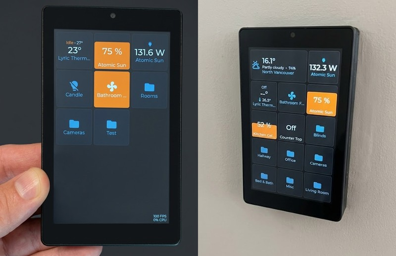

# Home Assistant Control

A Home Assistant touch panel for ESP32, ESP32-S3 and ESP32-P4 boards, built on ESP-IDF 6.1 with
LVGL. Design: [docs/architecture.md](docs/architecture.md), UI: [docs/ui/](docs/ui/README.md),
new boards: [docs/adding-a-board.md](docs/adding-a-board.md), open items:
[docs/TODO.md](docs/TODO.md), what changed: [docs/CHANGELOG.md](docs/CHANGELOG.md).



## Features

<!-- Keep this list current: a feature that is new, changed or gone changes it in the same commit (CLAUDE.md). -->

**Dashboard**

- Tiles for lights (switch with its level while on, or a dimmer with a level drag), switches, buttons, scenes and scripts,
  thermostats, locks, automations and scripts, sensors and binary sensors, cameras and weather, with
  Material Design icons.
- Clock tiles, digital or analog (hands, ticks, rim), 24 or 12 h, seconds, date, in the device's
  time zone or any IANA zone.
- Areas are pages of their own, nested as deep as needed, with a back tile or swipe navigation.
- A grid per page up to 32x32, tiles up to 8x8; size, place and visibility per orientation.
- Panels a tile opens: light (level, color, color temperature, effects, on/off timeline), climate
  (target, modes, presets, fan, room temperature graph), sensor (history graph of 12 to 48 h; a
  timeline for on/off and other two-word states such as Detected/Clear), lock (lock, unlock, open,
  timeline), automation and script (enabled switch, last run, run or stop, timeline), weather
  (current values, daily and hourly forecast). A double tap on a switch opens its timeline, on a
  light that dims the light panel; a double tap on a lock locks or unlocks it, on an automation or
  a script runs it.
- Camera tiles from Home Assistant's images or an MJPEG stream (go2rtc, Home Assistant), a full
  screen live view that comes back by itself after a dropped stream.
- Edit mode on the screen: long press, drag tiles around, remove them, per orientation; a "+" on
  every free cell adds a tile (entity found by a search in Home Assistant), an area or a clock;
  a tap on a tile changes its title, entity and options.
- Live values over one WebSocket to Home Assistant (`wss://` with certificate check), feedback
  while an action runs or fails, a start screen until the first values come, an alert strip for
  errors and hints.

**Screen and device**

- Dark theme on LVGL 8.4. A pull-down opens Settings: Wi-Fi, hotspot, Home Assistant state,
  display, sound, camera, alarm, system.
- Brightness, dimming and screen off after a time, automatic brightness from a light sensor,
  rotation from an orientation sensor or by hand, wake on motion with a motion sensor.
- Touch feedback (click, slider ticks, vibration) and an alarm clock with beeps or MP3 files, on
  boards with a speaker or a motor. Home Assistant makes the device speak a text (tts) or play an
  MP3 with the event `hassctrl_say`.
- The camera of a board (ESP32-P4): preview and picture settings on the screen, an MJPEG stream
  and JPEG snapshots on the web, behind a login.
- Local GPIO switch: relays switched from Home Assistant. Local GPIO sensor: a motion sensor
  reported to Home Assistant, held Detected for 1 to 60 min after the last motion. Both found by the device's name, no setup (see "Supported hardware").

**Setup and network**

- First setup from the screen or from a phone over the device's hotspot with a captive portal;
  QR codes to join the hotspot and to open the web UI.
- Up to 5 saved Wi-Fi networks in a chosen order or by signal, fast reconnect, mDNS
  (`hassctrl-xxxx.local`), time from SNTP with the time zone of Home Assistant.

**Web UI**

- Status, Home Assistant (URL, token, connection test), Wi-Fi, hotspot, camera, the dashboard
  editor (preview per orientation, entity picker, YAML import with includes and export), logs with
  a debug mode and a width to drag, system (backup export and import, updates, restart, factory reset). Plain HTTP
  with a login.

**Updates and recovery**

- Firmware and file system updates over the network: file upload, URL download or
  `tools/update.py`; every image is checked for chip, project and board; a firmware that does
  not confirm itself is rolled back.
- A recovery app in its own partition with the same Wi-Fi, hotspot and login, a web page built
  into it and a text screen; 4 MB boards update through it.
- Settings in NVS, secrets never in a file that can be downloaded; the dashboard and the web
  files on LittleFS.

**Development**

- A Windows version of the UI with sample states and scripted screenshots, host tests on MSVC for
  the pure components, a serial console with screenshots and virtual taps, one build script for
  every board and app.
- Board variants: a private folder per unit, outside git, changes the options a board has (pins,
  sensor calibration, config); the board in the repository is the example.

## Supported hardware

<!-- Keep this list current too: a chip, bus or option that is new, changed or gone changes it in the same commit. -->

- Chips: ESP32, ESP32-S3, ESP32-P4 (+ ESP32-C6 Wi-Fi)
- Panels: SPI (ST7796S, ILI9341), QSPI (AXS15231B), MIPI-DSI (ST7701S)
- Touch: FT6336U, GT911, AXS15231B
- Local GPIO switch: up to 4 relays, from `input_boolean.<device>_relay_<n>` / `switch.`; optional internal pullup (open drain, closed at boot)
- Local GPIO sensor: motion sensor (PIR or radar, active high or low), to `input_text.<device>_motion`, wakes the screen
- Orientation sensor: MPU6050
- Light sensor: BH1750 or LDR
- Vibration motor
- Speaker: I2S amplifier (NS4168) or codec (ES8311)
- Camera: MIPI-CSI (OV02C10, ESP32-P4)

## Build

Open a PowerShell prepared with the ESP-IDF activation script of EIM, then use the build script.
It keeps one build directory per board and application (`build/<board>/<app>`).
In a plain shell every tool fails with "IDF_PATH is not set"; the activation line goes first in every
PowerShell call (also for `tools/build_fs.py` and `tools/update.py`).

```powershell
. C:\Espressif\tools\Microsoft.v6.1.PowerShell_profile.ps1

python tools/build.py wt32_sc01                      # build the main firmware
python tools/build.py wt32_sc01 --app recovery       # build the recovery app
python tools/build.py wt32_sc01 menuconfig           # configure one board and app
python tools/build.py wt32_sc01.kitchen              # the variant "kitchen" of the board
```

## Boards

| Board | `tools/build.py` name | Notes |
| --- | --- | --- |
| Wireless-Tag WT32-SC01 | `wt32_sc01` | ESP32, 480x320, the first target |
| Guition JC3248W535 | `jc3248w535` | ESP32-S3, 320x480 QSPI panel (whole frames only) |
| Guition JC4880P443C-I-W | `jc4880p443c` | ESP32-P4, 480x800 MIPI-DSI, Wi-Fi through an ESP32-C6 |
| LilyGO TTGO T4 | `ttgo_t4` | test device only, no touch |

Which of the options of "Supported hardware" a board or a unit has is set in its board file
or its variant (below).

**Variants.** One unit of a board with other add-ons than the board file in the repository
(the pins of its LDR, vibration motor or relays, the calibration of its MPU6050, a config option)
is a variant: a private directory `boards/<board>/variants/<name>/`, ignored by git, with a copy
of `components/board/src/variant/hc_board_variant.hpp` that changes those fields and, if wanted,
an `sdkconfig.defaults` read last. It is built, flashed and given its web image as
`<board>.<name>` (`wt32_sc01.kitchen`, output in `build/wt32_sc01.kitchen/`). The board files in
the repository keep an example of every add-on. Steps: [docs/adding-a-board.md](docs/adding-a-board.md)
"Variants".

Pins, verified settings and quirks: [docs/devices/](docs/devices/). The ESP32-C6 of the
JC4880P443C has firmware of its own (`boards/jc4880p443c/c6`), updated from the P4 with the
console command `c6 update <url>`, see its device page.

## Tests on the PC

The pure components (`memory`, `formats`, `core`, `config`, `hass_protocol`, the URL code of
`hass`, the network choice of `network`) are compiled for the PC with MSVC of Visual Studio 2022 and tested there. No ESP-IDF
activation is needed; the script finds Visual Studio and the cmake and ninja that ESP-IDF
installs. cJSON comes from `managed_components/`, so build the firmware once first.

```powershell
python tools/host_test.py              # build and run every test
python tools/host_test.py config_      # only the tests whose name contains "config_"
```

## The UI on the PC

The Windows version of the UI (`host/sim/`) runs the screens of `components/ui` in a window, for
the design review: LVGL 8.4 with the firmware's settings, the same fonts and text widths, the mouse
as the finger. It shows only the GUI. The data comes from a stub of `hc::ui::Backend` with sample
states ("scenarios": connected, no network, hotspot on, Home Assistant token rejected, ...), and
a tap changes them (a network is forgotten, a connect succeeds or fails). The dashboard shows
the dashboard file with sample values made up from the entities' domains and names; a tap on a
tile acts on them. Same compiler and tools as the tests; build the firmware once first so
`managed_components/lvgl__lvgl` exists. The icon fonts and the web editor's
`web/icons.svg` are generated files: `python tools/build_icons.py` (needs Node.js and the network once)
after the icon list of `core` changed; commit the output, then flash the firmware and the web image.

```powershell
python tools/sim.py                          # build and open the window (480x320)
python tools/sim.py --size 320x480 --zoom 2  # a board's size (wt32, jc3248, t4, vga, p4), 2x pixels
python tools/sim.py --scenario hotspot --page hotspot
python tools/sim.py --dashboard my/hass.yaml   # the dashboard file (default docs/dashboard-sample/hass.yaml)
python tools/sim.py --dashboard none           # no dashboard: the start screen stays
python tools/sim.py --list                   # scenarios, pages, keys
```

In the window: `R` rotates (the window turns like the panel), `S` / `Shift+S` or `1`-`9` change the
scenario, `F12` saves a screenshot, `Q` quits. Without a person at the window, a script of taps
renders into a PNG and exits (time only moves when a step waits, so `wait 11000` is free):

```powershell
python tools/sim.py --page display --do "tap Rotation 0" --do "tap Rotate" --screenshot out.png
python tools/sim.py --scenario token-rejected --wait 11500 --screenshot strip.png
```

Steps of `--do`: `page NAME`, `scenario NAME`, `rotate`, `tap TEXT` (a label on the screen) or
`tap X,Y`, `swipe X1,Y1,X2,Y2`, `wait MS`, `shot FILE`. `python tools/sim.py --help` lists all
options. The simulator checks `host/sim/lv_conf.h` against the firmware's sdkconfig on every run
and says when a value differs.

## Flash

The recovery app goes to the factory partition and brings the bootloader and the partition table
with it, so it is flashed first. The main firmware goes to the OTA partition; the build script
does that instead of a plain `idf.py flash`, which would overwrite the recovery app.

```powershell
python tools/build.py wt32_sc01 --app recovery -p COM9 flash
python tools/build.py wt32_sc01 -p COM9 flash monitor
```

Flashing the recovery app also resets the boot selection: the device starts the recovery app
until a main firmware is flashed or uploaded.

**Firmware and web UI go together.** The dashboard editor of the web UI (`web/dashboard.js`)
copies rules of the firmware (the placement of the tiles, the sizes of a kind, the kinds of the
domains) and uses its API. A firmware with any change to the dashboard (its format, its rules, its
API) is flashed together with the web image built from the same commit:

```powershell
python tools/build.py wt32_sc01 -p COM9 flash
python tools/build_fs.py wt32_sc01 -p COM9
```

The ports of the developer's boards: WT32-SC01 COM9, JC3248W535 COM10, JC4880P443C COM11,
TTGO T4 COM13. `python tools/screenshot.py COM9 out.png` takes a screenshot of a running board
over the serial console.

## Web UI

The web pages are in `web/` (plain HTML, CSS and JavaScript, Bootstrap 5.3 CSS in
`web/vendor/`, no build step). Every main firmware build also builds the file system image
`build/<board>/fs/storage.bin` from them (`tools/build_fs.py`: gzipped into `/www`, sized for
the board's "storage" partition). Upload it on the System page, with `tools/update.py`, or over
serial with `python tools/build_fs.py <board> -p COM9`. Without the image the device serves its
built-in page; `/recovery` always serves that page.

The image replaces the whole partition, where the dashboard (`/fs/dashboard.json`) lives too.
Over serial, `build_fs.py` reads the board's partition first and keeps every file outside `/www`
(`--fresh` keeps nothing). An upload on the System page or with `update.py` does not: export the
dashboard first (Dashboard, Import & export) and import it afterwards. A dashboard of format
version 1 (a firmware before 2026-10-14) is converted once with `python tools/convert_dashboard.py`
before the import.

## Update over the network

Once a device runs, firmware and file system images go over the network: the System part of the
web page (file or URL), or the script, which logs in, goes through the recovery app on 4 MB
boards and waits for the new firmware:

```powershell
python tools/update.py 192.168.0.206 firmware build/ttgo_t4/main/hassctrl.bin
python tools/update.py 192.168.0.206 filesystem build/ttgo_t4/fs/storage.bin
```

The password is asked for, or taken from `HC_PASSWORD`.

`python tools/test_web.py 192.168.0.206` checks the web server of a running device (login,
refusals, load, a stalled client); it changes nothing on the device. `python tools/test_dashboard.py
192.168.0.206` checks the dashboard API; it replaces the dashboard on the device with the sample.
